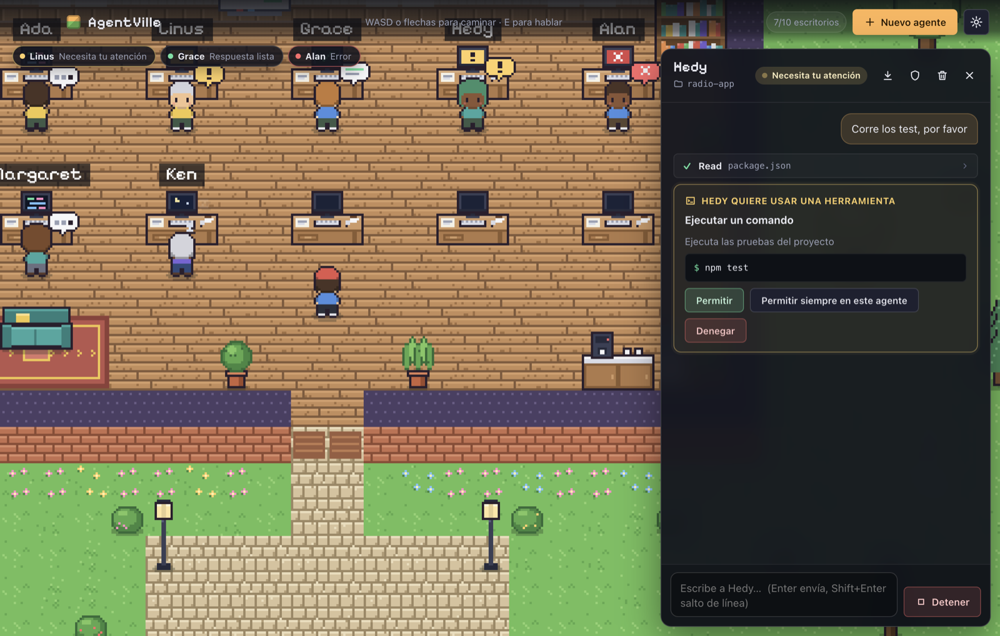
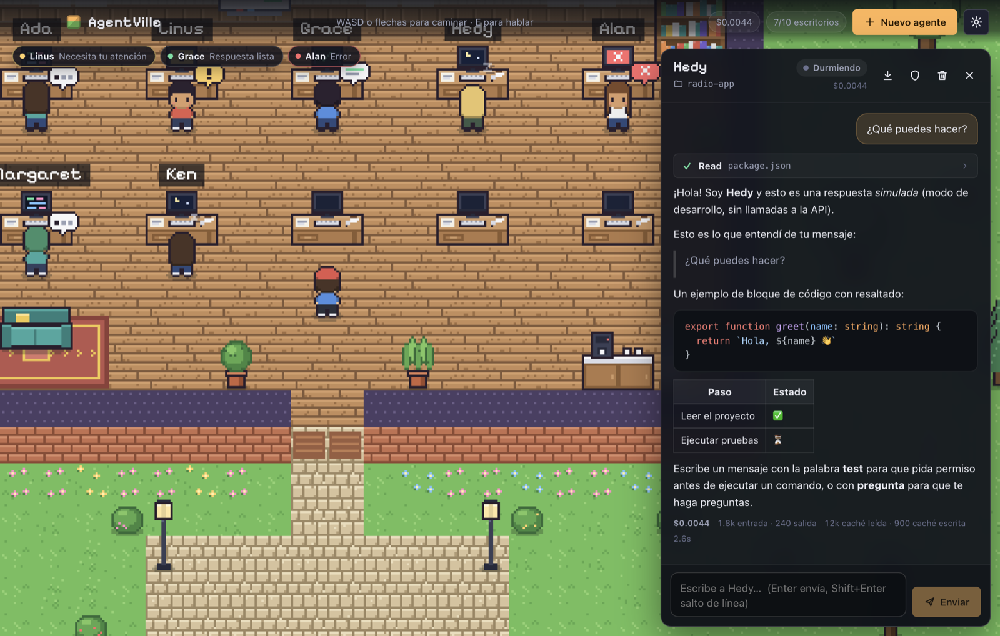
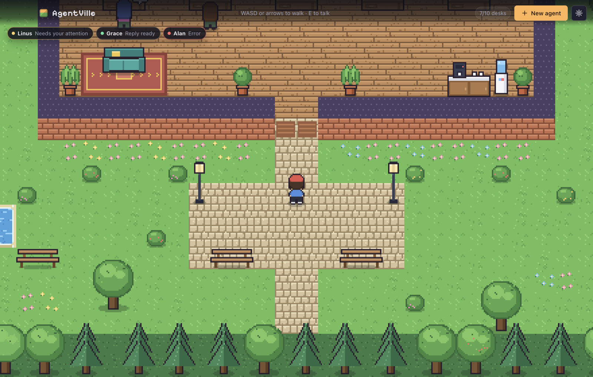

<p align="center">
  
</p>

<h1 align="center">AgentVille</h1>

<p align="center">
  Un pueblo pixel art donde viven tus agentes de programación.<br />
  Acércate a uno, pulsa <kbd>E</kbd> y empieza a hablar.
</p>

<p align="center">
  <a href="README.md">English</a> · <b>Español</b>
</p>

> [!IMPORTANT]
> **AgentVille no es un producto oficial de Anthropic.** Es un proyecto open source independiente de la comunidad, construido sobre el [Claude Agent SDK](https://code.claude.com/docs/en/agent-sdk/overview). No está afiliado ni respaldado por Anthropic. Usas tu propia API key de Anthropic.



## ¿Qué es?

AgentVille es una app de escritorio local donde cada chat con un agente de programación es un personaje de una pequeña oficina estilo 16 bits. Caminas con tu propio personaje, te acercas a un agente y abres su chat en un panel lateral, como en cualquier app de chat. Además, el agente muestra en el mundo lo que está haciendo: teclea en su escritorio, dormita cuando está inactivo y levanta un **!** cuando necesita tu aprobación.

Cada agente trabaja en una carpeta de proyecto de tu ordenador y ejecuta el mismo bucle de agente y las mismas herramientas que Claude Code (leer y editar archivos, ejecutar comandos, buscar…), a través del Claude Agent SDK.

## Funciones

- **Un pueblo para recorrer.** Muévete con <kbd>WASD</kbd> o las flechas, con colisiones, una cámara que te sigue y zoom con la rueda del ratón. Todo el arte está dibujado por código.
- **Un agente por proyecto.** *Nuevo agente* pide un nombre y una carpeta (diálogo nativo) y sienta al agente en un escritorio libre. Hasta 10 escritorios.
- **Panel de chat.** Respuestas en streaming con Markdown, tablas y bloques de código resaltados; la actividad de las herramientas aparece en línea; <kbd>Enter</kbd> envía y <kbd>Shift</kbd>+<kbd>Enter</kbd> hace un salto de línea.
- **Tu configuración de Claude Code funciona.** Los agentes cargan tus ajustes de usuario y de proyecto (`~/.claude` y `.claude/`), así que `CLAUDE.md`, skills, plugins, hooks y servidores MCP funcionan como siempre.
- **Tú apruebas lo que se ejecuta.** Los comandos, las ediciones de archivos y otras herramientas piden permiso primero: **Permitir**, **Permitir siempre en este agente** o **Denegar**. Las reglas recordadas solo valen para ese agente y se pueden quitar. Las preguntas del agente aparecen como tarjetas de opción múltiple.
- **Personajes vivos.** Duermen (zZz) cuando están inactivos y no gastan tokens, teclean mientras trabajan, muestran **!** cuando te necesitan, un globo de error cuando algo falló y una pantalla verde cuando hay una respuesta lista. El HUD indica quién te necesita y recibes una notificación del sistema si la ventana está en segundo plano.
- **Costos a la vista.** Costo y tokens de cada respuesta, un total por agente y un total general en Ajustes, según lo que informa el SDK (son estimaciones; tu factura real está en la consola de Anthropic).
- **Retoma donde lo dejaste.** Los agentes, sus carpetas, escritorios, session_id, historial, costos y tu posición se guardan localmente; al reabrir la app, cada agente retoma su conversación.
- **Detén** cualquier respuesta en curso y **exporta** cualquier chat a Markdown.
- Interfaz en español e inglés.

<p align="center">
  
  
</p>

## Instalación

### Requisitos

- macOS, Windows o Linux.
- [Node.js](https://nodejs.org) 20.19 o superior (solo para compilar desde el código).
- Una API key de Anthropic. Créala en la [consola de Anthropic](https://platform.claude.com/settings/keys).

### Ejecutar desde el código

```bash
git clone https://github.com/arvabranch/AgentVille.git
cd AgentVille
npm install
npm run dev
```

La primera vez, AgentVille te pide la API key. Después pulsa **Nuevo agente**, elige una carpeta de proyecto, acércate a tu nuevo agente y pulsa <kbd>E</kbd>. El idioma se cambia en **Ajustes**.

### Generar un instalador

```bash
npm run dist
```

Los instaladores quedan en `release/<versión>/` (`.dmg`/`.zip` en macOS, `.exe` en Windows, `.AppImage`/`.deb` en Linux). Compila en el sistema operativo de destino: la app incluye el binario nativo de Claude Code para esa plataforma (unos 360 MB). Por defecto los builds no están firmados ni notarizados; en macOS llevan firma ad-hoc, así que una copia descargada puede necesitar *clic derecho → Abrir* la primera vez.

## Trae tu propia API key

- La key se comprueba con una petición gratuita (listar modelos) y se guarda **cifrada** con `safeStorage` de Electron (Llavero de macOS, DPAPI en Windows, libsecret en Linux). Nunca se escribe en texto plano, nunca se envía al proceso de la interfaz y nunca aparece en los logs. En Linux sin llavero, AgentVille se niega a guardarla.
- Los agentes solo usan **tu API key**. AgentVille no ofrece «login con Claude.ai» ni usa credenciales de suscripción: los procesos de los agentes arrancan con un entorno limpio (sin variables `ANTHROPIC_*` ni de Claude Code heredadas) y una sesión que informe credenciales de suscripción se detiene.
- En **Ajustes** puedes cambiar o borrar la key y abrir las páginas de **Facturación**, **Uso** y **API keys** de la consola.

## Cómo funciona

```
┌──────────── Interfaz (sandbox) ────────────┐        ┌──────────── Proceso principal ────────────┐
│  React (HUD, chat, ajustes)                │ IPC    │  Agentes, escritorios, sesiones           │
│  Pueblo en Phaser 3 (mapa, personajes)     │◄tipado►│  Key cifrada (safeStorage)                │
│  sin Node.js, sin API key                  │preload │  Datos locales (JSON)                     │
└────────────────────────────────────────────┘        └────────────────┬──────────────────────────┘
                                                                       │ un query() por agente
                                                                       ▼
                                                      Claude Agent SDK → binario de Claude Code
                                                      (cwd = carpeta del agente) → API de Anthropic
```

- Cada agente despierto tiene un `query()` del Agent SDK en modo *streaming input*: `cwd` es su carpeta, `settingSources` es `user`, `project` y `local`, el prompt de sistema usa el preset `claude_code`, `permissionMode: 'default'` con un callback `canUseTool` que muestra las tarjetas de aprobación, y mensajes parciales para el streaming.
- Tras 10 minutos de inactividad el agente se duerme: su proceso termina. El siguiente mensaje retoma la misma sesión (`resume: sessionId`).
- Los datos locales viven en la carpeta de datos de la app (`~/Library/Application Support/AgentVille` en macOS, `%APPDATA%\AgentVille` en Windows, `~/.config/AgentVille` en Linux): `state.json`, `history/<agente>.json` y el archivo cifrado `secrets.bin`. Claude Code guarda sus propias transcripciones en `~/.claude/projects/`.

## Seguridad

- `contextIsolation`, `sandbox` en la interfaz y sin `nodeIntegration`. La interfaz solo habla con el proceso principal mediante un preload con un contrato IPC tipado y en lista blanca; los argumentos se validan con zod y se comprueba el remitente.
- Content Security Policy estricta, interfaz servida desde un protocolo propio `app://`, navegación y ventanas nuevas bloqueadas, permisos del navegador denegados y *fuses* de Electron activados en los builds empaquetados.
- Los agentes se ejecutan en tu equipo con los permisos de tu usuario, dentro de la carpeta que elegiste. Lee las tarjetas de aprobación antes de permitir un comando. Las reglas «Permitir siempre» solo valen para ese agente.

Consulta [SECURITY.md](SECURITY.md) para informar de una vulnerabilidad.

## Controles

| Tecla | Acción |
| --- | --- |
| <kbd>WASD</kbd> / flechas | Caminar |
| <kbd>E</kbd> o clic | Hablar con el agente más cercano |
| Rueda del ratón | Zoom |
| <kbd>Esc</kbd> | Cerrar el panel de chat |
| <kbd>Enter</kbd> / <kbd>Shift</kbd>+<kbd>Enter</kbd> | Enviar / salto de línea |

## Desarrollo

| Script | Qué hace |
| --- | --- |
| `npm run dev` | Arranca la app con recarga en caliente |
| `npm run build` | Comprueba tipos y compila en `out/` |
| `npm run lint` | ESLint |
| `npm run typecheck` | TypeScript (main, preload y renderer) |
| `npm test` | Pruebas unitarias (Vitest) |
| `npm run dist` | Genera instaladores con electron-builder |

`AGENTVILLE_MOCK=1 npm run dev` usa agentes simulados (sin key ni llamadas a la API) y `AGENTVILLE_DEMO=1 npm run dev` abre un pueblo de demostración en una carpeta de datos temporal. Consulta [CONTRIBUTING.md](CONTRIBUTING.md) para ver todas las opciones de desarrollo y la estructura del proyecto.

## Hoja de ruta

Hay planes para salas multijugador, un servidor MCP de navegador, plantillas de agente y un editor de mapas. Consulta [ROADMAP.md](ROADMAP.md).

## Licencia y créditos

[MIT](LICENSE). Todo el arte es original y está generado por código; consulta [ASSETS.md](ASSETS.md) para la fuente y otros recursos de terceros.

Claude y Anthropic son marcas registradas de Anthropic, PBC. AgentVille no está afiliado ni respaldado por Anthropic.
