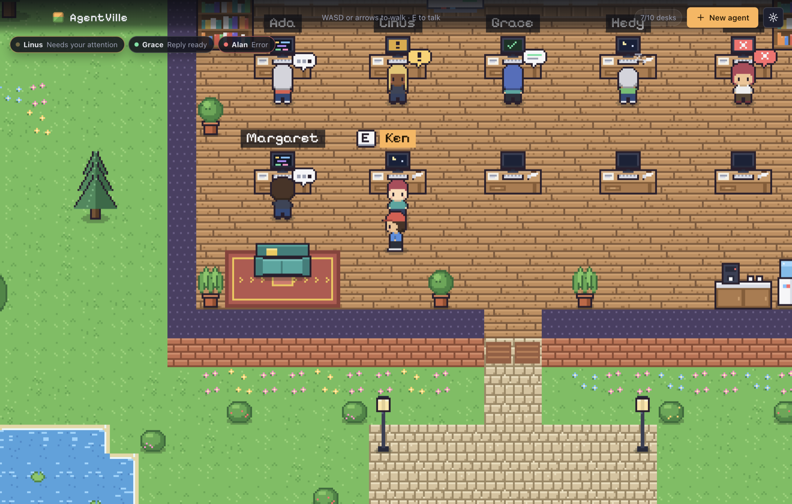
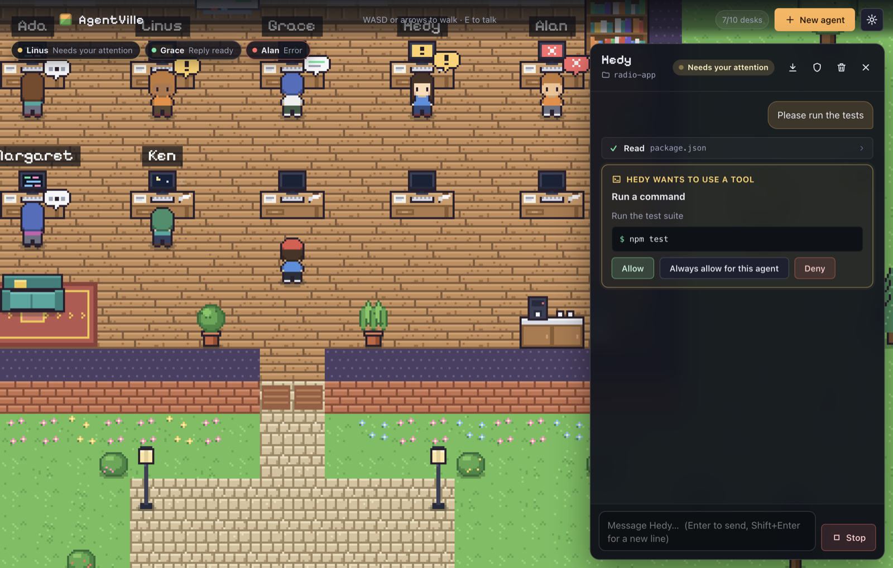
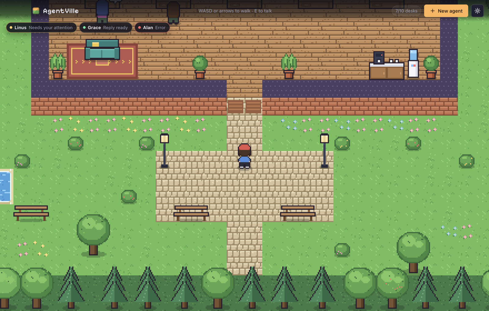

<p align="center">
  
</p>

<h1 align="center">AgentVille</h1>

<p align="center">
  A pixel-art town where your AI coding agents live.<br />
  Walk up to one, press <kbd>E</kbd> and start chatting.
</p>

<p align="center">
  <b>English</b> · <a href="README.es.md">Español</a>
</p>

> [!IMPORTANT]
> **AgentVille is not an official Anthropic product.** It is an independent, community open source project built on the [Claude Agent SDK](https://code.claude.com/docs/en/agent-sdk/overview). It is not affiliated with or endorsed by Anthropic. You bring your own Anthropic API key.



## What is it?

AgentVille is a local desktop app where every chat with a coding agent is a character in a small 16-bit style office. You walk around with your own character, approach an agent and open its chat in a side panel, just like a regular chat app, but the agent also shows what it is doing in the world: typing at its desk, dozing when idle, raising a **!** when it needs your approval.

Each agent works in one project folder on your computer and runs the same agent loop and tools as Claude Code (read and edit files, run commands, search…), through the Claude Agent SDK.

## Features

- **A town to walk around.** Move with <kbd>WASD</kbd> or the arrow keys, with collisions, a camera that follows you and zoom on the mouse wheel. All the art is drawn by code.
- **One agent per project.** *New agent* asks for a name and a folder (native dialog) and seats the agent at a free desk. Up to 10 desks.
- **Chat panel.** Streaming replies with Markdown, tables and highlighted code blocks; tool activity shown inline; <kbd>Enter</kbd> to send, <kbd>Shift</kbd>+<kbd>Enter</kbd> for a new line.
- **Your Claude Code setup works.** Agents load your user and project settings (`~/.claude` and `.claude/`), so `CLAUDE.md`, skills, plugins, hooks and MCP servers work as usual.
- **You approve what runs.** Commands, file edits and other tools ask first, with **Allow**, **Always allow for this agent** or **Deny**. Remembered rules apply to that agent only and can be removed. Clarifying questions show up as multiple-choice cards.
- **Living characters.** Sleeping (zZz) when idle and using no tokens, typing while working, **!** when they need you, an error bubble when something failed, a green screen when a reply is ready. The HUD lists who needs you, and you get a system notification when the window is in the background.
- **Costs in sight.** Cost and tokens for every reply, a total per agent and a global total in Settings, as reported by the SDK (estimates; your real bill is in the Anthropic Console).
- **Picks up where you left off.** Agents, their folders, desks, session IDs, chat history, costs and your position are saved locally; reopening the app resumes each agent's conversation.
- **Stop** any reply in progress and **export** any chat to Markdown.
- English and Spanish interface.

<p align="center">
  
  
</p>

## Install

### Requirements

- macOS, Windows or Linux.
- [Node.js](https://nodejs.org) 20.19 or newer (only to build from source).
- An Anthropic API key. Create one in the [Anthropic Console](https://platform.claude.com/settings/keys).

### Run from source

```bash
git clone https://github.com/arvabranch/AgentVille.git
cd AgentVille
npm install
npm run dev
```

On first launch AgentVille asks for your API key. Then click **New agent**, pick a project folder, walk up to your new agent and press <kbd>E</kbd>.

### Build an installer

```bash
npm run dist
```

Installers land in `release/<version>/` (`.dmg`/`.zip` on macOS, `.exe` on Windows, `.AppImage`/`.deb` on Linux). Build on the operating system you are targeting: the app ships the native Claude Code binary for that platform (about 360 MB). Builds are not code-signed or notarized by default; on macOS they are ad-hoc signed, so a downloaded copy may need *right-click → Open* the first time.

## Bring your own API key

- The key is checked with a free request (listing models) and then stored **encrypted** with Electron's `safeStorage` (macOS Keychain, Windows DPAPI, libsecret on Linux). It is never written in plain text, never sent to the UI process and never logged. On Linux without a keyring, AgentVille refuses to store it.
- Agents only ever use **your API key**. AgentVille does not offer claude.ai login and does not use subscription credentials: agent processes start with a clean environment (no inherited `ANTHROPIC_*` or Claude Code variables) and a session that reports subscription credentials is stopped.
- In **Settings** you can change or delete the key and open the Console pages for **Billing**, **Usage** and **API keys**.

## How it works

```
┌────────────── Renderer (sandboxed) ──────────────┐        ┌──────────── Main process ────────────┐
│  React UI (HUD, chat, settings)                  │  typed │  Agents, desks, sessions             │
│  Phaser 3 town (map, characters, bubbles)        │◄──IPC─►│  Encrypted key (safeStorage)         │
│  no Node.js, no API key                          │preload │  Local data (JSON)                   │
└──────────────────────────────────────────────────┘        └──────────────┬───────────────────────┘
                                                                           │ one query() per agent
                                                                           ▼
                                                          Claude Agent SDK → Claude Code binary
                                                          (cwd = the agent's project folder) → Anthropic API
```

- Each awake agent has one Agent SDK `query()` in streaming input mode: `cwd` is its folder, `settingSources` is `user`, `project` and `local`, the `claude_code` system prompt preset, `permissionMode: 'default'` with a `canUseTool` callback that shows the approval cards, and partial messages for streaming.
- After 10 minutes idle an agent falls asleep: its process exits. The next message resumes the same session (`resume: sessionId`).
- Local data lives in the app data folder (`~/Library/Application Support/AgentVille` on macOS, `%APPDATA%\AgentVille` on Windows, `~/.config/AgentVille` on Linux): `state.json`, `history/<agent>.json` and the encrypted `secrets.bin`. Claude Code keeps its own session transcripts under `~/.claude/projects/`.

## Security

- `contextIsolation`, renderer `sandbox` and no `nodeIntegration`. The UI talks to the main process only through a preload with an allow-listed, typed IPC contract; arguments are validated with zod and the sender is checked.
- Strict Content Security Policy, UI served from a custom `app://` protocol, navigation and new windows blocked, browser permissions denied, Electron fuses enabled in packaged builds.
- Agents run on your machine with your user's permissions, inside the folder you chose. Read the approval cards before allowing a command. "Always allow" rules only apply to that agent.

See [SECURITY.md](SECURITY.md) to report a vulnerability.

## Controls

| Key | Action |
| --- | --- |
| <kbd>WASD</kbd> / arrows | Walk |
| <kbd>E</kbd> or click | Talk to the nearest agent |
| Mouse wheel | Zoom |
| <kbd>Esc</kbd> | Close the chat panel |
| <kbd>Enter</kbd> / <kbd>Shift</kbd>+<kbd>Enter</kbd> | Send / new line |

## Development

| Script | What it does |
| --- | --- |
| `npm run dev` | Start the app with hot reload |
| `npm run build` | Type-check and build to `out/` |
| `npm run lint` | ESLint |
| `npm run typecheck` | TypeScript (main, preload and renderer) |
| `npm test` | Unit tests (Vitest) |
| `npm run dist` | Build installers with electron-builder |

`AGENTVILLE_MOCK=1 npm run dev` runs simulated agents (no key, no API calls) and `AGENTVILLE_DEMO=1 npm run dev` opens a demo town in a throwaway data folder. See [CONTRIBUTING.md](CONTRIBUTING.md) for all developer options and the project layout.

## Roadmap

Multiplayer rooms, a browser MCP server, agent templates and a map editor are planned. See [ROADMAP.md](ROADMAP.md).

## License and credits

[MIT](LICENSE). All the art is original and generated by code; see [ASSETS.md](ASSETS.md) for the font and other third-party resources.

Claude and Anthropic are trademarks of Anthropic, PBC. AgentVille is not affiliated with or endorsed by Anthropic.
